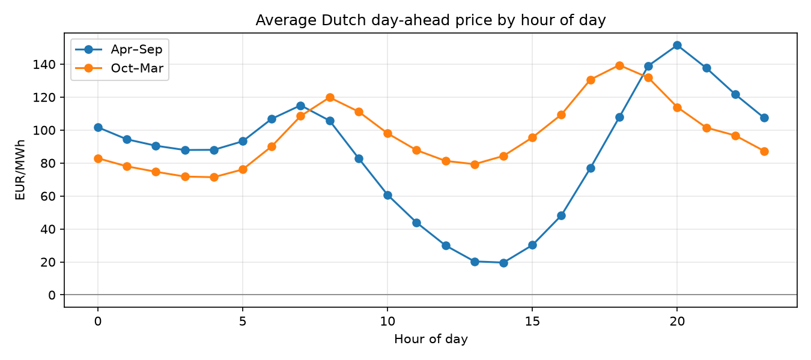
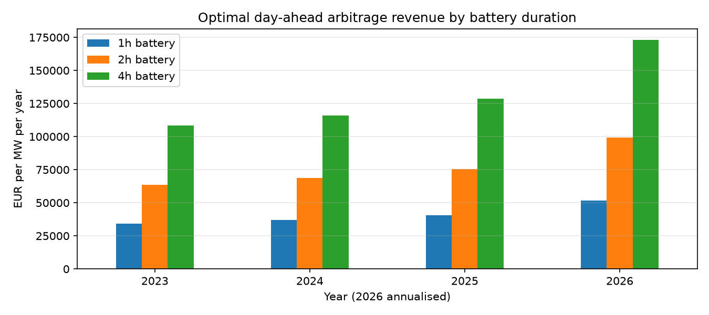
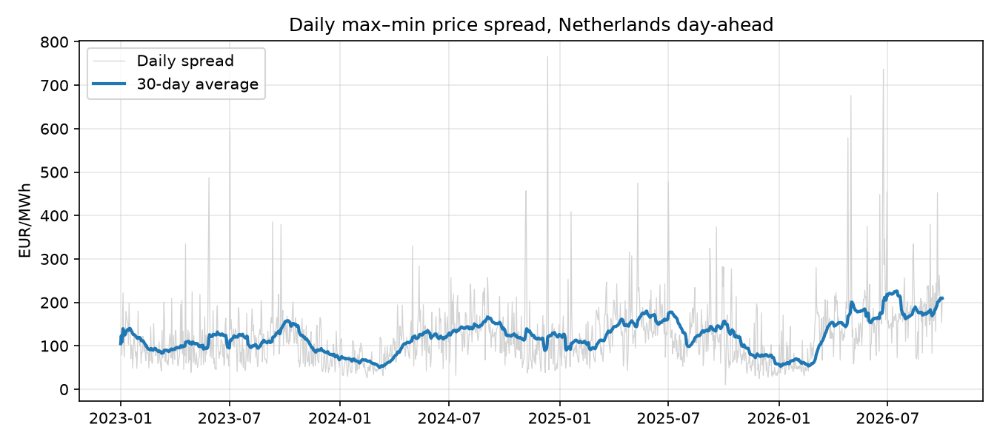

# How much can a battery earn on the Dutch power market?

A small, reproducible analysis of **day-ahead arbitrage value for grid-scale batteries (BESS) in the Netherlands**, using real hourly prices from January 2023 to September 2026.

The question: if a battery only buys power when it's cheap and sells it when it's expensive on the day-ahead market, how much could it earn per MW per year, how does that depend on battery duration (1h, 2h, 4h), and is the opportunity growing?

**Tools:** SQL (DuckDB) for market statistics, Python (pandas, SciPy) for a mixed-integer optimisation model, Matplotlib for charts.

---

## Key findings

**1. The market is getting more volatile, and that's good for storage.**

| Year | Avg price (EUR/MWh) | Avg daily spread (max − min) | Negative-price hours |
|---|---|---|---|
| 2023 | 95.8 | 107.6 | 316 |
| 2024 | 77.3 | 113.0 | 458 |
| 2025 | 86.8 | 123.2 | 584 |
| 2026 (Jan–Sep) | 108.1 | 156.0 | 388 |

The average daily spread rose about 45% from 2023 to 2026, and negative-price hours almost doubled between 2023 and 2025. Both point to more solar on the grid and more need for flexibility.

**2. The solar "duck curve" is the trade.** In April–September the average price drops to about €20/MWh at 14:00 and peaks around €150/MWh at 20:00. A battery charges at midday and sells in the evening peak.



**3. Day-ahead arbitrage revenue for a 2-hour battery rose from about €64k to €99k per MW per year.**

| Duration | 2023 | 2024 | 2025 | 2026 (annualised) |
|---|---|---|---|---|
| 1h | €34k | €37k | €40k | €52k |
| 2h | €64k | €69k | €76k | €99k |
| 4h | €109k | €116k | €129k | €173k |



**4. Longer duration has diminishing returns.** A 4h battery has twice the energy of a 2h battery but earns only about 1.7× as much, because the extra hours are traded at less extreme prices. Whether the extra capacity is worth it depends on how much it costs per MWh.

**5. A simple rule gets most of the value, but less for longer batteries.** "Charge in the cheapest midday hours, discharge in the most expensive evening hours" captures 74–89% of the optimal revenue for a 2h battery, but only 65–83% for a 4h battery. Smarter scheduling matters more as duration grows.



---

## Method

**Data.** Dutch day-ahead prices from the [Energy-Charts API](https://api.energy-charts.info/) (Fraunhofer ISE, CC BY 4.0). Since October 2025 the market clears in 15-minute periods; these are averaged to hourly values so the whole period is on one consistent basis. 32,855 hourly prices in total.

**SQL (`sql/`).** Daily min/max/spread and negative-price hours, a yearly summary, an hour-of-day profile by season, and a 30-day rolling average with a window function.

**Optimisation (`src/battery.py`).** For each day, a mixed-integer linear programme chooses the hourly charge and discharge that maximise revenue, subject to:
- 1 MW power, 1h / 2h / 4h energy capacity
- 88% round-trip efficiency
- at most one full cycle per day
- the battery starts and ends each day empty
- it can't charge and discharge in the same hour

That last constraint matters. My first version was a plain linear programme, and on 124 of 1,369 days it "cheated" during negative prices by charging and discharging at the same time to burn energy through efficiency losses. A binary charge/discharge variable fixed this (`src/sanity_checks.py` now finds 0 such days).

**Checks (`src/sanity_checks.py`).** A toy day with a hand-calculated answer (model and hand calculation both give €166.30), plus the check above.

---

## Limitations (read before using the numbers)

These numbers are an **upper bound for day-ahead arbitrage only**, not a full business case:

- **Perfect knowledge within the day.** Day-ahead prices are known the day before, so this is reasonable for day-ahead trading, but real operators also make forecasting and bidding errors.
- **Other revenue streams are excluded.** In the Netherlands, much of battery revenue comes from balancing services (FCR, aFRR) and the imbalance market. These aren't modelled.
- **Costs are excluded.** No grid transport tariffs, battery degradation, trading fees or financing costs. Grid tariffs in particular can be significant for Dutch batteries.
- **Hourly averaging since Oct 2025** understates the spreads a battery could capture at 15-minute resolution.
- **2026 is annualised from January–September**, so it misses the Q4 pattern.

## Possible next steps

- Add a battery degradation cost per MWh cycled, and see at what cost per cycle the 4h battery stops being worth it
- Use 15-minute prices from October 2025 onwards
- Compare with Germany and Belgium to see where storage value is highest
- Add a simple revenue estimate for aFRR balancing

---

## How to run

```bash
pip install -r requirements.txt
python src/fetch_prices.py    # downloads ~45 months of prices (a few minutes; the free API is rate-limited)
python src/analysis.py        # SQL statistics, battery model, charts -> outputs/
python src/sanity_checks.py   # model checks
```

Run all commands from the project folder.

*Built by Jeong A (Jay) Jeong, MSc Quantitative Finance, University of Amsterdam.*
